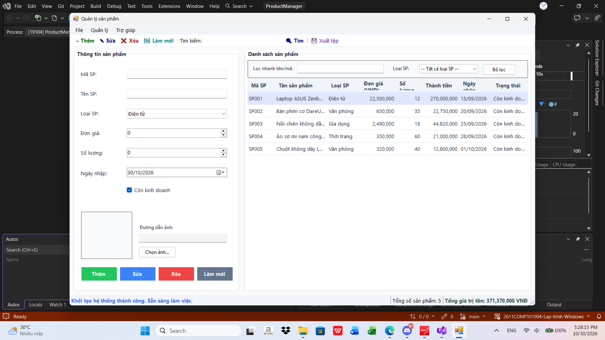
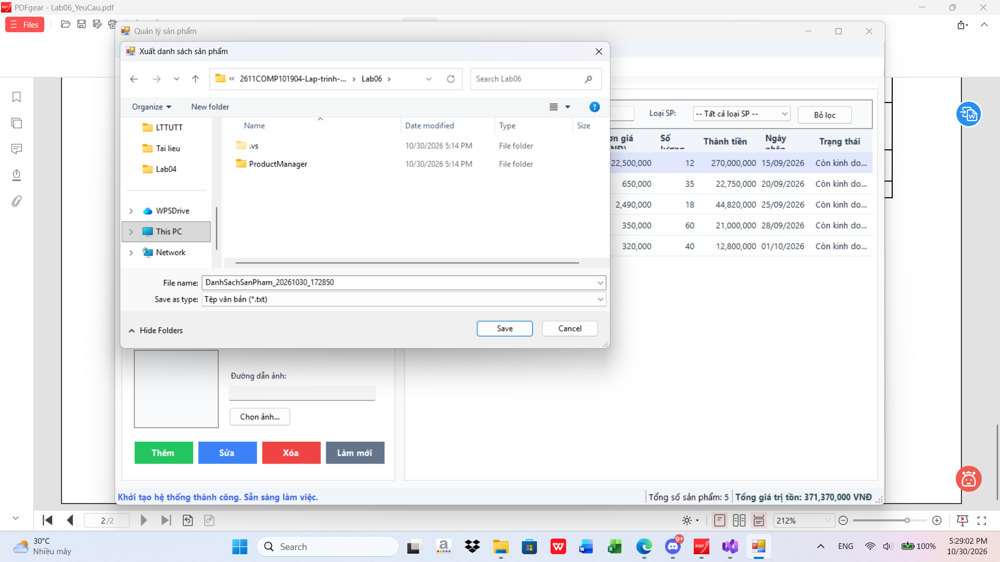
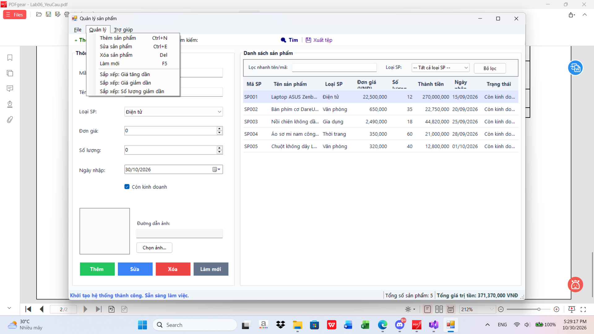

# Lab 06 - Windows Forms Nâng cao và DataGridView (ProductManager)

## Thông tin sinh viên
- **Họ và tên**: Hoàng Dương Phúc Quang
- **MSSV**: 49.01.101.075
- **Lớp**: 49.01.TOAN.SN
- **Nhóm**: 11
- **Học phần**: COMP1019 - Lập trình trên Windows
- **Giảng viên hướng dẫn**: ThS. Lê Thanh Thoại
- **Buổi thực hành**: Buổi 6 (Lab 06) - Windows Forms Nâng cao và DataGridView

---

## 1. Mục tiêu bài thực hành
- Thiết kế màn hình quản lý dữ liệu chuyên nghiệp, bố cục khoa học chuẩn UI Windows Forms.
- Trình bày danh sách sản phẩm trực quan bằng `DataGridView` với đầy đủ định dạng số tiền, ngày tháng và trạng thái.
- Hiện thực các thao tác dữ liệu trong bộ nhớ: **Thêm**, **Sửa**, **Xóa**, **Tìm kiếm**, **Làm mới**, **Lọc danh mục** và **Sắp xếp**.
- Kiểm tra tính hợp lệ dữ liệu nhập (Validation) chặt chẽ bằng sự kết hợp giữa `ErrorProvider` và `MessageBox`.
- Sử dụng đầy đủ hệ thống điều khiển thanh menu và thanh công cụ:
  - `MenuStrip` (File, Quản lý, Trợ giúp)
  - `ToolStrip` (Thêm, Sửa, Xóa, Làm mới, Tìm kiếm, Xuất tệp)
  - `StatusStrip` (Hiển thị trạng thái thao tác, tổng số sản phẩm và tổng giá trị kho hàng)
  - `ContextMenuStrip` (Nhấn chuột phải trên dòng DataGridView: Sửa, Xóa, Xem chi tiết)
- Tích hợp `OpenFileDialog` để chọn và nạp hình ảnh sản phẩm vào `PictureBox`.
- Tích hợp `SaveFileDialog` để xuất danh sách sản phẩm ra tệp văn bản `.txt` báo cáo.

---

## 2. Cấu trúc thư mục mã nguồn
```text
Lab06/
├── README.md                                    # Báo cáo chi tiết và hướng dẫn sử dụng Lab 06
├── ProductManager.sln                           # Solution Visual Studio chuẩn
├── ProductManager.slnx                          # Solution định dạng hiện đại (VS 2022+)
└── ProductManager/
    ├── ProductManager.csproj                    # File cấu hình dự án C# WinForms (.NET Framework 4.7.2)
    ├── App.config                               # Cấu hình runtime ứng dụng
    ├── Program.cs                               # Điểm khởi chạy ứng dụng (Main Entry Point)
    ├── Models/
    │   └── Product.cs                           # Lớp thực thể Product lưu trữ dữ liệu sản phẩm
    ├── FrmProduct.cs                            # Mã xử lý nghiệp vụ, sự kiện và tương tác dữ liệu
    ├── FrmProduct.Designer.cs                   # Thiết kế bố cục giao diện chính FrmProduct
    ├── FrmProduct.resx                          # Tài nguyên giao diện FrmProduct
    ├── FrmProductDetail.cs                      # Mã xử lý cửa sổ popup xem chi tiết sản phẩm
    ├── FrmProductDetail.Designer.cs             # Giao diện xem chi tiết sản phẩm và ảnh phóng to
    ├── FrmProductDetail.resx                    # Tài nguyên giao diện FrmProductDetail
    └── Properties/
        ├── AssemblyInfo.cs                      # Thông tin định danh Assembly
        ├── Resources.Designer.cs
        ├── Resources.resx
        ├── Settings.Designer.cs
        └── Settings.settings
```

---

## 3. Bảng ánh xạ Controls trên giao diện chính (`FrmProduct`)

| Nhóm điều khiển | Loại Control | Tên Control (`Name`) | Chức năng & Ràng buộc |
| :--- | :--- | :--- | :--- |
| **Thông tin nhập liệu** | `TextBox` | `txtMaSP` | Mã sản phẩm (Không rỗng, không được trùng, tự động khóa khi sửa) |
| **Thông tin nhập liệu** | `TextBox` | `txtTenSP` | Tên sản phẩm (Không được để trống) |
| **Thông tin nhập liệu** | `ComboBox` | `cboLoaiSP` | Loại sản phẩm: *Điện tử, Văn phòng, Gia dụng, Thời trang* (`DropDownList`) |
| **Thông tin nhập liệu** | `NumericUpDown` | `numDonGia` | Đơn giá sản phẩm (Lớn hơn 0, bước nhảy 50.000 VNĐ, định dạng phân cách hàng nghìn) |
| **Thông tin nhập liệu** | `NumericUpDown` | `numSoLuong` | Số lượng tồn kho (Lớn hơn hoặc bằng 0) |
| **Thông tin nhập liệu** | `DateTimePicker` | `dtpNgayNhap` | Ngày nhập hàng (Định dạng `dd/MM/yyyy`, không lớn hơn ngày hiện tại) |
| **Thông tin nhập liệu** | `CheckBox` | `chkConKinhDoanh` | Trạng thái: Còn kinh doanh / Ngừng kinh doanh |
| **Thông tin nhập liệu** | `PictureBox` | `picProduct` | Hiển thị hình ảnh minh họa sản phẩm (`SizeMode: Zoom`) |
| **Thông tin nhập liệu** | `TextBox` | `txtDuongDanAnh` | Đường dẫn file ảnh đã chọn (`ReadOnly = true`) |
| **Thông tin nhập liệu** | `Button` | `btnChonAnh` | Mở hộp thoại `OpenFileDialog` để chọn file hình ảnh |
| **Nút thao tác Form** | `Button` | `btnThem` | Thêm sản phẩm mới |
| **Nút thao tác Form** | `Button` | `btnSua` | Cập nhật thông tin sản phẩm đang chọn |
| **Nút thao tác Form** | `Button` | `btnXoa` | Xóa sản phẩm đang chọn sau khi xác nhận |
| **Nút thao tác Form** | `Button` | `btnLamMoi` | Làm sạch ô nhập liệu và khôi phục form |
| **Bảng hiển thị** | `DataGridView` | `dgvProducts` | `ReadOnly = true`, `SelectionMode = FullRowSelect`, `MultiSelect = false` |
| **Lọc danh sách** | `TextBox` | `txtQuickSearch` | Lọc tức thời theo mã hoặc tên sản phẩm |
| **Lọc danh sách** | `ComboBox` | `cboLocLoaiSP` | Lọc sản phẩm theo từng danh mục loại sản phẩm |
| **Thanh trạng thái** | `StatusStrip` | `lblStatus` | Hiển thị thông báo trạng thái thao tác hiện tại |
| **Thanh trạng thái** | `StatusStrip` | `lblTotalCount` | Tổng số lượng mặt hàng hiện có |
| **Thanh trạng thái** | `StatusStrip` | `lblTotalValue` | Tổng giá trị tồn kho toàn cửa hàng (`DonGia * SoLuong`) |
| **Menu ngữ cảnh** | `ContextMenuStrip` | `cmsProduct` | Gắn vào DataGridView: Sửa, Xóa, Xem chi tiết |
| **Kiểm tra hợp lệ** | `ErrorProvider` | `errProvider` | Đánh dấu cảnh báo lỗi trực quan trên từng control |

---

## 4. Các trường dữ liệu của lớp `Product`

```csharp
public class Product
{
    public string MaSP { get; set; }           // Mã sản phẩm (Không rỗng, duy nhất)
    public string TenSP { get; set; }          // Tên sản phẩm (Không rỗng)
    public string LoaiSP { get; set; }         // Loại sản phẩm (Chọn từ ComboBox)
    public decimal DonGia { get; set; }        // Đơn giá (> 0)
    public int SoLuong { get; set; }           // Số lượng (>= 0)
    public DateTime NgayNhap { get; set; }     // Ngày nhập (<= DateTime.Today)
    public bool ConKinhDoanh { get; set; }     // Trạng thái kinh doanh
    public string DuongDanAnh { get; set; }    // Đường dẫn file ảnh

    public decimal TongTien => DonGia * SoLuong; // Thành tiền tự động tính toán
    public string TrangThaiKinhDoanh => ConKinhDoanh ? "Còn kinh doanh" : "Ngừng kinh doanh";
}
```

---

## 5. Hiện thực các yêu cầu chức năng

### 5.1. Khi tải Form (`FrmProduct_Load`)
- Khởi tạo danh sách loại sản phẩm vào cả `cboLoaiSP` (nhập liệu) và `cboLocLoaiSP` (bộ lọc tìm kiếm nhanh).
- Nạp sẵn **5 sản phẩm mẫu** phong phú đầy đủ các ngành hàng (Điện tử, Văn phòng, Gia dụng, Thời trang).
- Cấu hình liên kết dữ liệu qua `BindingSource` và `BindingList<Product>`.
- Cập nhật số lượng sản phẩm và tổng giá trị tồn kho ban đầu lên `StatusStrip`.

### 5.2. Chức năng Thêm sản phẩm
- Gọi hàm `ValidateInput(isEditing: false)`.
- Kiểm tra mã sản phẩm không được trùng lặp với các sản phẩm đã có trong danh sách.
- Khởi tạo thực thể `Product` mới, đưa vào danh sách, tự động cập nhật bảng hiển thị, làm mới form và thông báo thành công.

### 5.3. Chức năng Sửa sản phẩm
- Người dùng chọn một dòng trên `dgvProducts`, thông tin tự động được đẩy lên vùng nhập liệu bằng hàm `LoadProductToForm(Product p)`.
- Khóa trường `txtMaSP` (`ReadOnly = true`) để đảm bảo toàn vẹn dữ liệu khóa chính.
- Khi người dùng chỉnh sửa thông tin và bấm **Sửa**, hệ thống validate dữ liệu mới và cập nhật lại đối tượng trong danh sách, đồng thời kích hoạt làm tươi bảng `dgvProducts`.

### 5.4. Chức năng Xóa sản phẩm
- Kiểm tra an toàn: Nếu người dùng chưa chọn sản phẩm nào, hệ thống hiển thị thông báo hướng dẫn thay vì gây lỗi ứng dụng.
- Xuất hiện hộp thoại xác nhận `MessageBox.Show(..., MessageBoxButtons.YesNo, MessageBoxIcon.Question)`. Chỉ thực hiện xóa khi người dùng chọn **Yes**.

### 5.5. Tìm kiếm và Lọc dữ liệu
- Tìm kiếm từ thanh `ToolStrip`: Hỗ trợ nhập mã hoặc tên sản phẩm, nhấn nút **Tìm** hoặc nhấn phím **Enter** trên bàn phím.
- Lọc tức thời (`TextChanged`): Ô tìm kiếm nhanh cho phép lọc danh sách theo thời gian thực không phân biệt chữ hoa/thường.
- Lọc theo danh mục: Chọn loại sản phẩm từ `cboLocLoaiSP` để lọc chính xác ngành hàng tương ứng.

### 5.6. Làm mới form (`ClearInput`)
- Xóa sạch các nội dung trên các ô nhập liệu, đưa ComboBox về phần tử đầu tiên, đưa ngày nhập về ngày hiện tại, bỏ chọn hình ảnh và xóa toàn bộ thông báo lỗi trên `ErrorProvider`.

### 5.7. Chọn ảnh sản phẩm (`OpenFileDialog`)
- Nhấn nút **Chọn ảnh...** để mở hộp thoại lọc ảnh định dạng `.jpg`, `.jpeg`, `.png`, `.bmp`, `.gif`.
- Hiển thị trực tiếp ảnh trong `picProduct` với chế độ thu phóng tỷ lệ chuẩn `SizeMode = Zoom`.

### 5.8. Cập nhật StatusStrip theo thời gian thực
- Cập nhật chuỗi thông báo thao tác vừa thực hiện: "Đã thêm...", "Đã sửa...", "Đã xóa...".
- Tự động thống kê tổng số mặt hàng và tính toán tổng giá trị tồn kho:
  $$\text{Tổng giá trị kho} = \sum (\text{Đơn giá} \times \text{Số lượng})$$

---

## 6. Các tính năng nâng cao & Mở rộng (Đạt điểm tối đa)
1. **Sắp xếp nâng cao**:
   - Menu *Quản lý -> Sắp xếp: Giá tăng dần*
   - Menu *Quản lý -> Sắp xếp: Giá giảm dần*
   - Menu *Quản lý -> Sắp xếp: Số lượng giảm dần*
2. **Xuất báo cáo ra file văn bản (.txt)**:
   - Menu *File -> Xuất danh sách...* hoặc nút **💾 Xuất tệp** trên thanh công cụ.
   - Sử dụng `SaveFileDialog` lưu bảng biểu căn chỉnh ngay ngắn, có thống kê tổng kết kho hàng.
3. **Menu ngữ cảnh và Xem chi tiết (Modal Dialog)**:
   - Chuột phải trên DataGridView mở menu `ContextMenuStrip` gồm: *Sửa*, *Xóa*, *Xem chi tiết*.
   - Chức năng *Xem chi tiết* mở cửa sổ popup `FrmProductDetail` trình bày đẹp mắt thông số và hình ảnh kích thước lớn.
4. **Phím tắt tiện lợi**:
   - `Ctrl+N`: Thêm sản phẩm
   - `Ctrl+E`: Sửa sản phẩm
   - `Delete`: Xóa sản phẩm
   - `F5`: Làm mới
   - `Ctrl+S`: Xuất danh sách
   - `Ctrl+O`: Chọn ảnh

---

## 7. Hướng dẫn biên dịch và thực thi

### Bằng Visual Studio
1. Mở file solution `ProductManager.sln` hoặc `ProductManager.slnx` bằng Visual Studio 2022.
2. Nhấn `Ctrl + Shift + B` để biên dịch toàn bộ solution.
3. Nhấn `F5` hoặc `Ctrl + F5` để chạy ứng dụng.

### Bằng MSBuild qua dòng lệnh
```powershell
& "C:\Program Files\Microsoft Visual Studio\18\Community\MSBuild\Current\Bin\MSBuild.exe" "Lab06\ProductManager\ProductManager.csproj" /t:Build /p:Configuration=Debug
```
File thực thi được tạo tại: `Lab06\ProductManager\bin\Debug\ProductManager.exe`.

## 8. Hình ảnh minh họa chạy chương trình

> Các ảnh chụp màn hình minh họa các bước kiểm thử chức năng được lưu trữ tại thư mục [`docs/screenshots/`](docs/screenshots/):

1.

2.

3.
