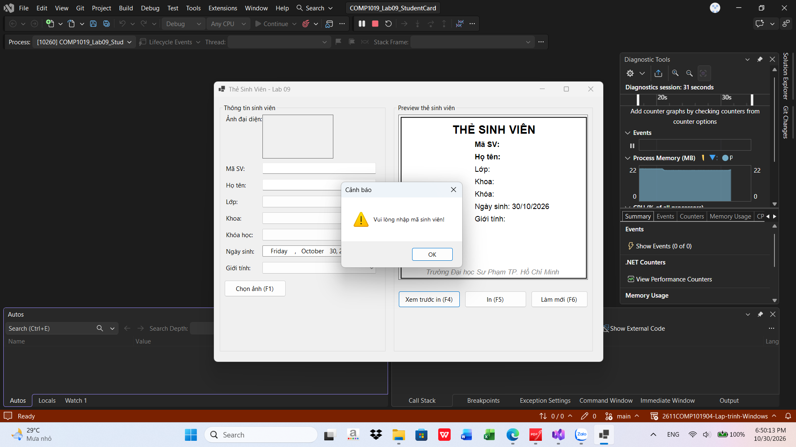
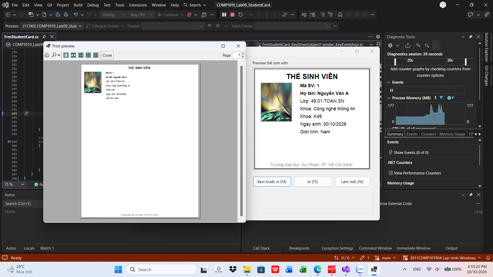
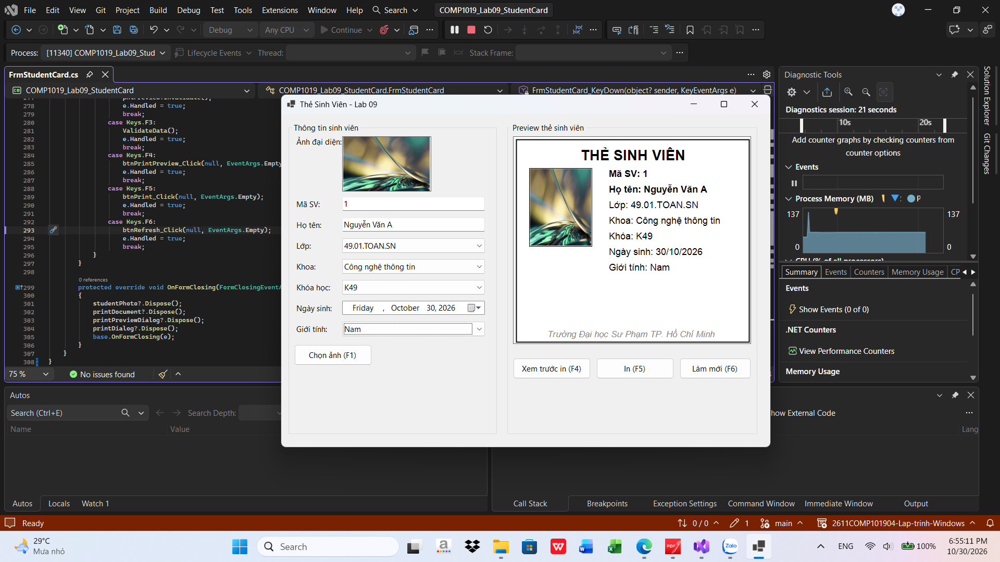

# Lab 09: Thiết kế và in thẻ sinh viên

## Thông tin sinh viên
- Họ tên: Hoàng Dương Phúc Quang
- MSSV: 49.01.101.075
- Lớp: 49.01.TOAN.SN
- Nhóm: 11

## Mô tả
Chương trình Windows Forms cho phép nhập thông tin sinh viên, chọn ảnh đại diện, xem trước thẻ bằng GDI+ và in thẻ bằng `PrintDocument`.

## Chức năng
- Nhập mã sinh viên, họ tên, lớp, khoa, khóa học, ngày sinh và giới tính.
- Chọn ảnh JPG, JPEG, PNG hoặc BMP bằng `OpenFileDialog`.
- Hiển thị ảnh trong `PictureBox` theo tỉ lệ phù hợp.
- Vẽ thẻ sinh viên trên Panel bằng sự kiện `Paint`.
- Kiểm tra mã sinh viên, họ tên và ảnh trước khi preview hoặc in.
- Xem trước bằng `PrintPreviewDialog`.
- In bằng `PrintDialog` và `PrintDocument`.
- Làm mới form bằng nút hoặc phím `F6`.
- Phím tắt: `F1` chọn ảnh, `F2` preview, `F3` kiểm tra, `F4` xem trước in, `F5` in.

## Cấu trúc chương trình
```text
COMP1019_Lab09_StudentCard/
├── FrmStudentCard.cs
├── FrmStudentCard.Designer.cs
├── Program.cs
└── Models/
    └── Student.cs
```

## Cách chạy
1. Mở `COMP1019_Lab09_StudentCard.csproj` bằng Visual Studio.
2. Build project.
3. Nhấn `F5` hoặc `Ctrl + F5` để chạy.

Có thể chạy bằng .NET CLI:
```powershell
dotnet run --project COMP1019_Lab09_StudentCard/COMP1019_Lab09_StudentCard.csproj
```

## Kiểm thử
| STT | Tình huống kiểm thử | Kết quả mong đợi |
|---:|---|---|
| 1 | Bấm **Xem trước** khi chưa nhập mã sinh viên | Hiển thị cảnh báo yêu cầu nhập mã sinh viên và không mở preview |
| 2 | Bấm **Xem trước** khi chưa nhập họ tên | Hiển thị cảnh báo yêu cầu nhập họ tên và không mở preview |
| 3 | Bấm **Xem trước** khi chưa chọn ảnh đại diện | Hiển thị cảnh báo yêu cầu chọn ảnh và không mở preview |
| 4 | Chọn ảnh JPG, PNG hoặc BMP hợp lệ | Ảnh được hiển thị trong `PictureBox` và giữ đúng tỉ lệ |
| 5 | Nhập đầy đủ thông tin sinh viên | Panel vẽ lại thẻ và hiển thị đúng thông tin đã nhập |
| 6 | Thay đổi thông tin sau khi preview | Nội dung Panel preview được cập nhật theo dữ liệu mới |
| 7 | Mở **Print Preview** khi dữ liệu hợp lệ | Hiển thị bản xem trước có khung, tiêu đề, ảnh và thông tin sinh viên |
| 8 | Bấm **In**, sau đó chọn máy in hoặc hủy `PrintDialog` | Cho phép chọn máy in khi xác nhận; hủy hộp thoại không làm ứng dụng lỗi |
| 9 | Nhấn `F6` để làm mới form | Xóa dữ liệu nhập, xóa ảnh và đưa form về trạng thái ban đầu |

## Hình ảnh minh họa chạy chương trình

> Các ảnh chụp màn hình minh họa các bước kiểm thử chức năng được lưu trữ tại thư mục [`docs/screenshots/`](docs/screenshots/):

1.

2.

3.
