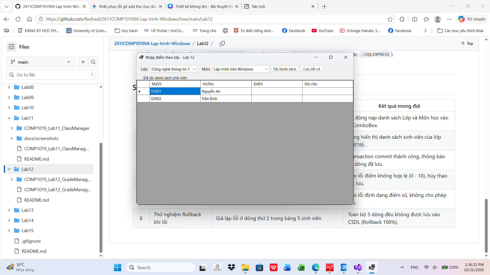
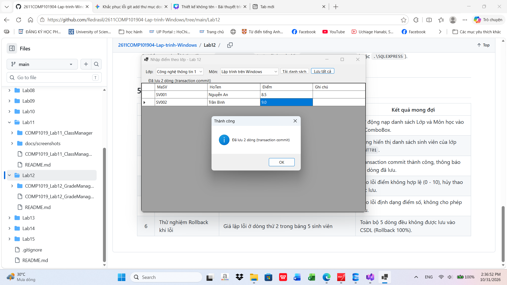
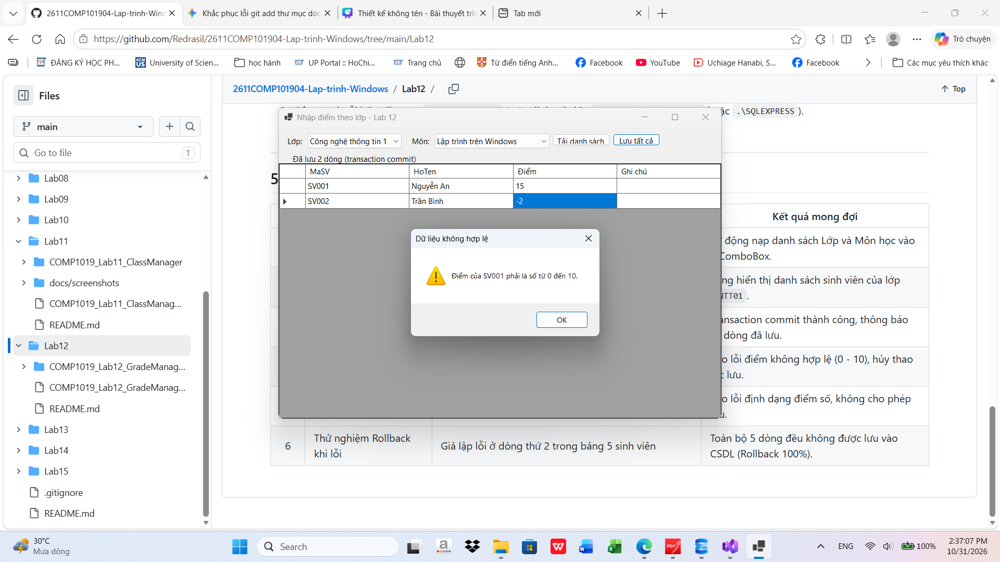
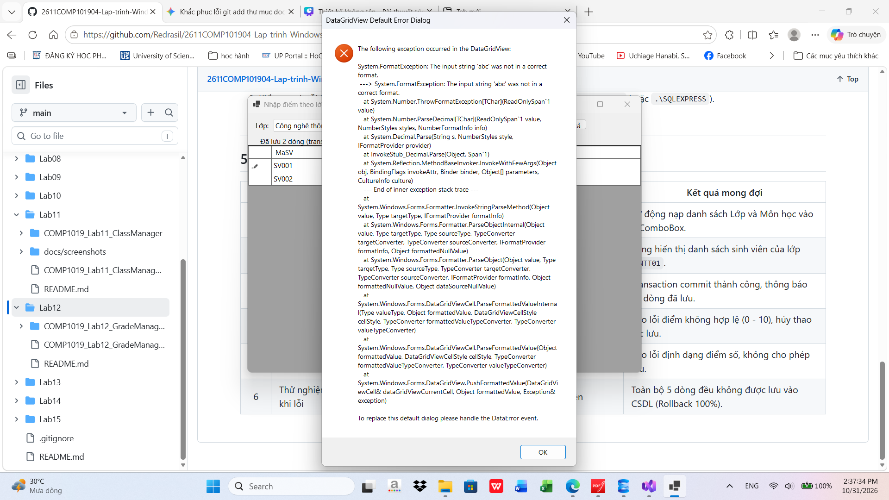

# Lab 12 - Data Binding, Stored Procedure và Transaction (COMP1019_Lab12_GradeManager)

## Thông tin sinh viên
- **Họ và tên**: Hoàng Dương Phúc Quang
- **MSSV**: 49.01.101.075
- **Lớp**: 49.01.TOAN.SN
- **Học phần**: COMP1019 - Lập trình trên Windows
- **Giảng viên hướng dẫn**: ThS. Lê Thanh Thoại

---

## 1. Mô tả bài toán & Cấu trúc kiến trúc
Module **Quản lý nhập điểm kết quả học tập theo lớp** kết nối CSDL SQL Server `QLSinhVienLab12`. Người dùng chọn Lớp và Môn học, hệ thống tải danh sách sinh viên tương ứng. Người dùng có thể nhập hoặc cập nhật điểm trực tiếp trên `DataGridView`. Toàn bộ dữ liệu được lưu an toàn xuống CSDL bằng **Transaction (Giao tác)** và **Stored Procedure**.

### Cấu trúc mã nguồn:
```text
Lab12/
├── README.md                                    # Báo cáo chi tiết và hướng dẫn
└── COMP1019_Lab12_GradeManager/
    ├── COMP1019_Lab12_GradeManager.csproj       # C# WinForms (.NET 8.0)
    ├── Program.cs                               # Điểm khởi chạy
    ├── DAL/
    │   ├── Database.cs                          # Chuỗi kết nối và tiện ích CSDL
    │   └── KetQuaDAL.cs                         # Xử lý truy vấn Stored Procedure & Transaction
    ├── Database/
    │   └── QLSinhVienLab12.sql                  # Script tạo CSDL, bảng, dữ liệu mẫu & SP
    └── Forms/
        ├── FrmNhapDiemTheoLop.cs                # Form nhập điểm theo lớp
        └── FrmNhapDiemTheoLop.Designer.cs
```

---

## 2. Danh sách Stored Procedure bắt buộc
1. `sp_Lop_GetAll`: Truy vấn toàn bộ danh sách lớp học để nạp vào `cboLop`.
2. `sp_MonHoc_GetAll`: Truy vấn danh sách môn học để nạp vào `cboMonHoc`.
3. `sp_KetQua_GetByLopMon`: Truy vấn danh sách sinh viên theo lớp và môn học, kết hợp điểm và ghi chú hiện có nếu đã nhập trước đó.
4. `sp_KetQua_Save`: Sử dụng câu lệnh `MERGE` (hoặc kiểm tra tồn tại): nếu sinh viên đã có điểm môn học thì `UPDATE`, nếu chưa có thì `INSERT`.

---

## 3. Cơ chế Transaction (Giao tác nhiều dòng an toàn)
Trong `KetQuaDAL.SaveGrades(string maMon, DataTable grades)`:
- Khởi tạo giao tác `using SqlTransaction transaction = connection.BeginTransaction();`.
- Duyệt qua từng dòng sinh viên trong bảng điểm:
  - Nếu gặp lỗi dữ liệu hoặc ngoại lệ SQL ở bất kỳ dòng nào, khối `catch` kích hoạt `transaction.Rollback();` -> **Hủy bỏ toàn bộ các dòng trước đó**, giữ nguyên trạng thái dữ liệu trong CSDL.
  - Nếu toàn bộ các dòng đều thành công, thực thi `transaction.Commit();` và thông báo số lượng dòng đã lưu thành công.

---

## 4. Hướng dẫn cài đặt & Chạy
1. Mở SQL Server Management Studio (SSMS).
2. Mở file `Database/QLSinhVienLab12.sql` và nhấn `Execute` để tạo CSDL, 4 bảng (`LOP`, `SINHVIEN`, `MONHOC`, `KETQUA`), dữ liệu mẫu và 4 Stored Procedures.
3. Kiểm tra chuỗi kết nối trong `DAL/Database.cs` (mặc định trỏ đến `(localdb)\MSSQLLocalDB` hoặc `.\SQLEXPRESS`).
4. Mở `COMP1019_Lab12_GradeManager.csproj` bằng Visual Studio 2022/.NET 8 và bấm `F5`.

---

## 5. Bảng kiểm thử (Test Cases)
| STT | Kịch bản kiểm thử | Thao tác / Dữ liệu nhập | Kết quả mong đợi |
|:---:|---|---|---|
| 1 | Khởi động Form | Mở Form `FrmNhapDiemTheoLop` | Tự động nạp danh sách Lớp và Môn học vào 2 ComboBox. |
| 2 | Tải danh sách sinh viên | Chọn lớp `CNTT01`, môn `Lập trình trên Windows` -> Bấm "Tải danh sách" | Bảng hiển thị danh sách sinh viên của lớp `CNTT01`. |
| 3 | Nhập điểm hợp lệ | Nhập điểm `8.5`, `9.0` -> Bấm "Lưu tất cả" | Transaction commit thành công, thông báo số dòng đã lưu. |
| 4 | Nhập điểm ngoài khoảng 0 - 10 | Nhập điểm `15` hoặc `-2` -> Bấm "Lưu tất cả" | Báo lỗi điểm không hợp lệ (0 - 10), hủy thao tác lưu. |
| 5 | Nhập điểm không phải số | Nhập chữ `"abc"` vào ô Điểm | Báo lỗi định dạng điểm số, không cho phép lưu. |
| 6 | Thử nghiệm Rollback khi lỗi | Giả lập lỗi ở dòng thứ 2 trong bảng 5 sinh viên | Toàn bộ 5 dòng đều không được lưu vào CSDL (Rollback 100%). |

## 6. Hình ảnh minh họa chạy chương trình

> Các ảnh chụp màn hình minh họa các bước kiểm thử chức năng được lưu trữ tại thư mục [`docs/screenshots/`](docs/screenshots/):

1.

2.

3.

4.
